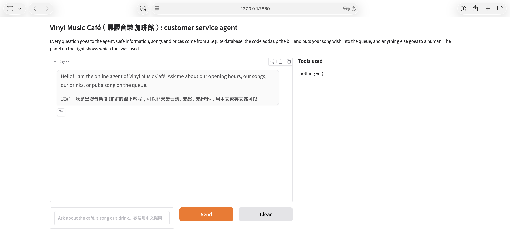
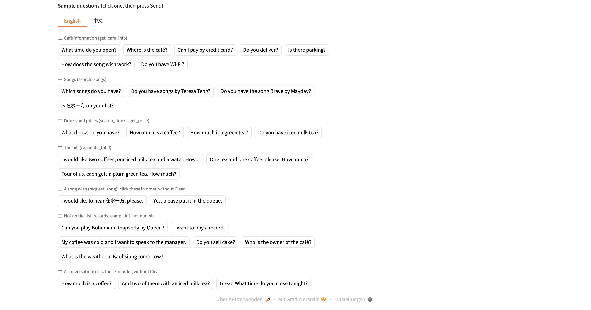
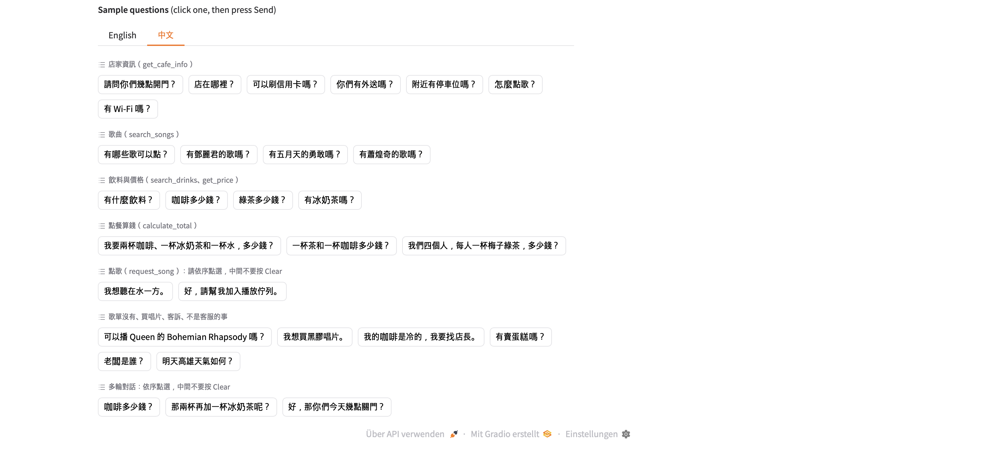
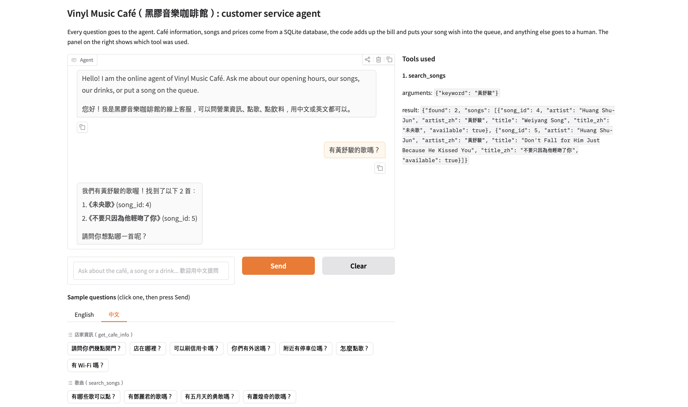
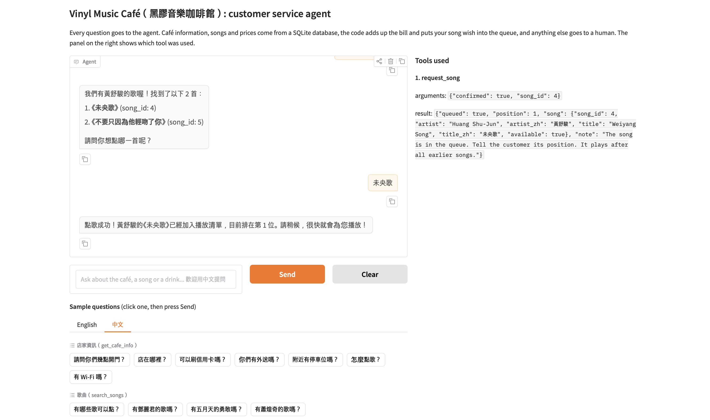
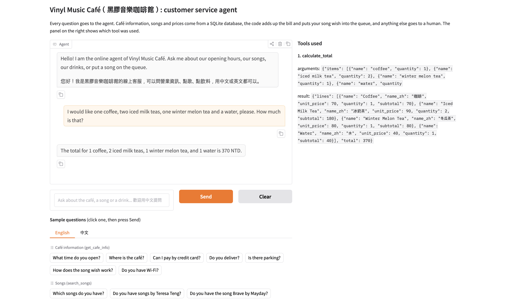
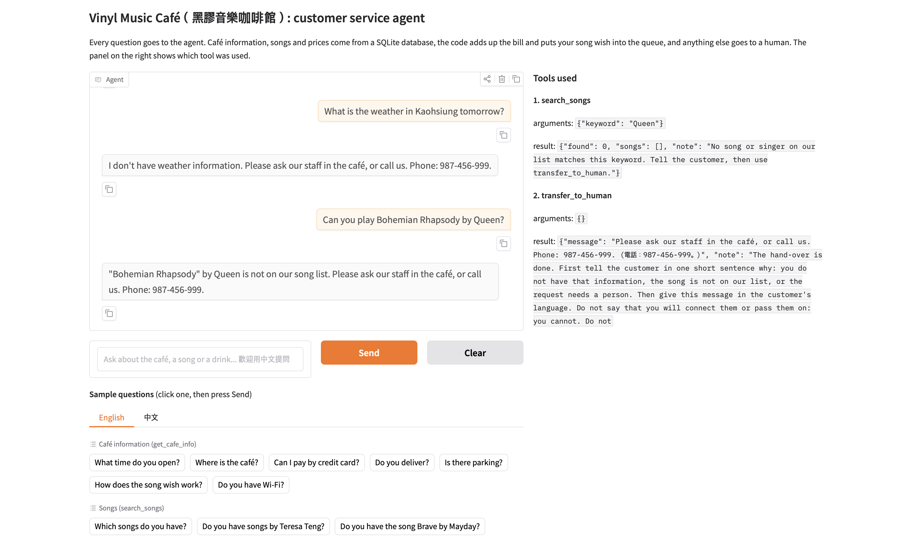

# Vinyl Music Café（黑膠音樂咖啡館）: Answers questions about the café, songs and drinks.

An AI customer service agent for a small, made-up music café in Kaohsiung with many vinyl records. Guests can ask about the café, look for songs, wish for a song, ask about drinks and prices, and get the total of an order, in English or in Traditional Chinese. The agent answers only from the café's own database through tools, so it does not make up opening hours, prices or songs.

> Course homework: Unit G, My AI Customer Service Agent, with a Database and Tools

> Student: C115451102 席喬安





## Who It Serves and When They Use It

- **Who uses it:** guests of the café: first-time visitors, regular guests and people who plan to come.
- **When they use it:** before their visit (opening hours, parking, payment, Wi-Fi) and during their visit (song wishes, drinks, the price of an order).
- **What problem it solves:** the staff do not have to answer the same questions again and again at the counter or on the phone, and guests get a correct answer from the café's own data instead of a guess from a general chatbot.

## What It Can Do

| Function | Example question | Tool it uses |
|---|---|---|
| Tell café information (hours, address, phone, payment, delivery, parking, Wi-Fi, reservation, how song wishes work) | "What time do you open?", "可以刷信用卡嗎？" | `get_cafe_info` |
| Find songs and singers | "Do you have songs by Huang Shu-Jun?", "有五月天的勇敢嗎？" | `search_songs` |
| Put a song wish into the queue (only after the guest says yes) | "I would like to hear 在水一方." then "Yes, please." | `search_songs`, `request_song` |
| List drinks and tell prices | "What drinks do you have?", "How much is a coffee?" | `search_drinks`, `get_price` |
| Work out the total of an order | "Two coffees and one iced milk tea. How much?" | `calculate_total` |
| Hand over to the staff (song not on the list, buying a record, complaint, manager) | "Can you play Bohemian Rhapsody by Queen?", "I want to buy a record." | `transfer_to_human` |

## How It Works

Every question goes to the agent first. The agent chooses a tool, the tool reads the database
or calculates in code, and the agent answers only from what the tool returns.

- **Model:** gemini-3.5-flash-lite
- **Chat screen:** Gradio (version 6)
- **Languages:** English and Traditional Chinese. The program decides the reply language, not the model.
- **Database (SQLite):** built from the CSV files every time the program starts.

  | Table | CSV file | What it holds | Rows |
  |---|---|---|---|
  | `cafe_info` | `cafe_info.csv` | topics such as opening hours, address, payment, parking (English and Chinese text) | 10 |
  | `songs` | `songs.csv` | singer and title of every song, in English and Chinese, and whether it is available | 16 |
  | `drinks` | `drinks.csv` | drink names in English and Chinese, category, price in NTD, available or not | 7 |
  | `queue` | (created empty at every start) | the song wishes that wait to be played | 0 at start |

- **Tools:**

  | Tool | What it does |
  |---|---|
  | `get_cafe_info(topic)` | reads one topic from `cafe_info` |
  | `search_songs(keyword)` | finds songs by singer or title, in English or Chinese |
  | `search_drinks(keyword)` | finds drinks by keyword, or lists all drinks |
  | `get_price(item_name)` | price and availability of one drink |
  | `calculate_total(items)` | price × quantity of every drink, added up in code |
  | `request_song(song_id, confirmed)` | writes a song into `queue`, only when `confirmed` is true (the guest said yes) |
  | `transfer_to_human()` | gives the staff phone number |

## Sample Conversations








## Project Files

```text
music-cafe-agent/
├── app-gradio.py       # the agent: database, tools, agent loop and chat screen
├── cafe_info.csv       # the information table
├── songs.csv           # records table 1: the songs
├── drinks.csv          # records table 2: the drinks
├── tool_test.py        # the tool-choice test (17 questions) and the song wish test
├── requirements.txt    # the Python packages to install
├── .env.example        # a sample settings file (no real key)
├── .gitignore          # files git must not upload: .env and *.db
├── images/             # screenshots for this README
└── README.md           # this file
```

## How to Install and Run It

1. Download the project:

   ```bash
   git clone https://github.com/YOUR-ACCOUNT/YOUR-REPO.git
   cd YOUR-REPO
   ```

2. Install the packages (Python 3.10 or newer):

   ```bash
   pip install -r requirements.txt
   ```

3. Make your settings file. Copy `.env.example` to `.env`, then fill in your own values.
   The model must support tool calling.

   ```bash
   copy .env.example .env      # Windows
   cp .env.example .env        # macOS or Linux
   ```

4. Start the agent. It builds the database from the CSV files, then starts the chat page:

   ```bash
   python app-gradio.py
   ```

5. Open the link shown in the console, usually <http://127.0.0.1:7860>.

To run the tool-choice test, stop the app first, then run:

```bash
python tool_test.py
```

## Notes

- All names, the address, the phone number, prices and the opening hours in the data are **made up**. The singers and song titles are real; the English song titles are my own translations and might not be correct. The original titles are in Chinese.
- The `.env` file holds the API key. It is **not** in this repository. Make your own from `.env.example`.
- The agent does not play music. It only takes song wishes into the queue. The queue is empty at every start, and the staff can change it themselves.
- On a free Gemini plan the number of calls per minute is limited, so the agent or the test script can get error 429 ("too many calls"). Wait a minute and try again.
